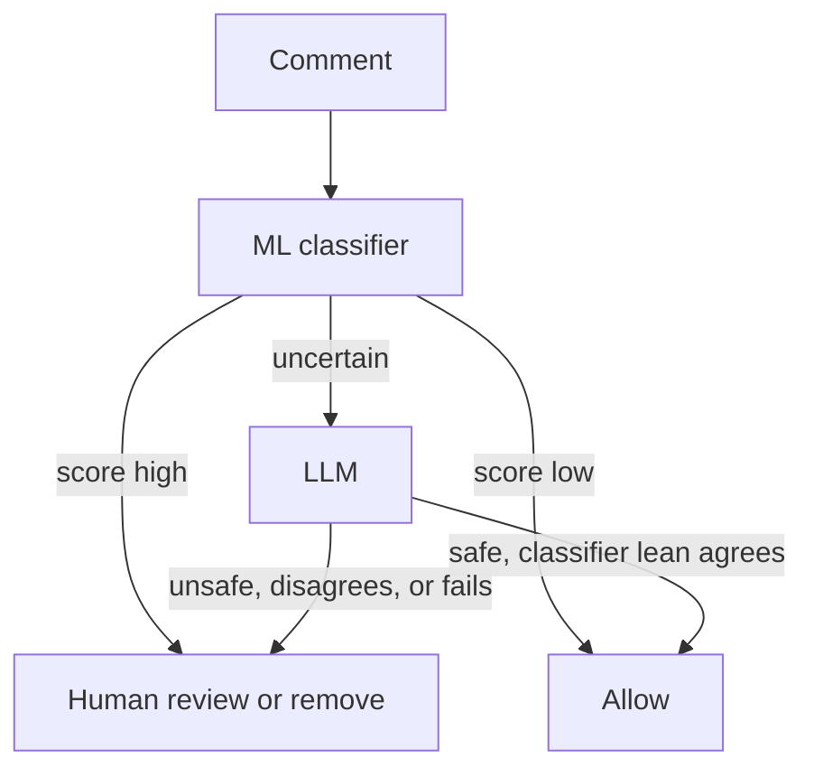

# Comment Moderator (hybrid classifier + LLM)

A comment moderation system built in small, measured versions. The question it tests: **can a cheap trained classifier resolve most comments on its own, with an LLM seeing only the uncertain ones?** Each version adds one piece and reports numbers, so every claim here is backed by a file in `results/`.

**Status:** V0 and V1 complete. Next: a separate validation split, prompt fixes tested on fresh data, and the full pipeline with a human-review path.

## Headline results so far

- A TF-IDF + logistic regression baseline reaches a toxic-class **F1 of 0.75** on the Jigsaw test split (31,915 comments).
- In V1, **Gemini 3.5 Flash-Lite did not beat that classifier**, overall or on the hard cases. It caught more toxic comments but also flagged more clean ones (higher recall, lower precision).
- A hybrid preview (classifier outside the uncertain band, LLM inside it) scored about the same F1 as the classifier alone (0.740 vs 0.747, intervals overlap) while cutting estimated LLM cost by about 80% versus LLM-only. This is exploratory, see limitations.

## Versions

| Version | What it adds                                                                   | Status  | Key numbers                                                   |
| ------- | ------------------------------------------------------------------------------ | ------- | ------------------------------------------------------------- |
| V0      | TF-IDF + logistic regression, binary toxic vs. not                             | Done    | Toxic F1 0.748 (P 0.658, R 0.866), macro-F1 0.857             |
| V0.1    | Confidence analysis and router simulation                                      | Done    | ~79% of traffic resolved at ~99% accuracy (cutoffs 0.2 / 0.9) |
| V1      | LLM-only baseline on 1,000 fixed comments, evaluation with bootstrap intervals | Done    | LLM F1 0.687 vs classifier 0.747 (overall estimate)           |
| V2      | Full pipeline with human-review path and LLM-failure handling, ablation table  | Planned |                                                               |
| V3      | Calibration and threshold tuning on a separate validation split                | Planned |                                                               |
| V4+     | Rule layer; prompt fixes tested on fresh data; LLM-labeled retraining loop     | Planned |                                                               |

## V0: baseline

- **Data:** Jigsaw Toxic Comment Classification Challenge `train.csv` (about 160k comments), split 80/20 with a fixed seed, stratified on the label.
- **Label definition:** "toxic" means **any** of the six Jigsaw categories is 1. This differs slightly from Jigsaw's own `toxic` column.
- **Model:** TF-IDF (50k features, 1-2 grams) into logistic regression with `class_weight="balanced"`.

| Class     | Precision | Recall | F1    | Support |
| --------- | --------- | ------ | ----- | ------- |
| not toxic | 0.984     | 0.949  | 0.966 | 28,670  |
| toxic     | 0.658     | 0.866  | 0.748 | 3,245   |

## V0.1: where does the classifier know what it is doing?

| Score band | Share of traffic | Actually toxic | Accuracy |
| ---------- | ---------------- | -------------- | -------- |
| 0.0 - 0.1  | 56.4%            | 0.2%           | 99.8%    |
| 0.1 - 0.3  | 23.6%            | 2.2%           | 97.8%    |
| 0.3 - 0.7  | 10.6%            | 17.7%          | 67.3%    |
| 0.7 - 0.9  | 3.3%             | 56.1%          | 56.1%    |
| 0.9 - 1.0  | 6.2%             | 93.8%          | 93.8%    |

With cutoffs 0.2 / 0.9, the classifier resolves 78.9% of traffic alone at 99.1% accuracy, and the other 21.1% (the "escalated band") contains 87.8% of its errors. Full sweep: `results/v0_binary_confidence.json`.

## V1: does an LLM fix the uncertain cases?

**Setup.** Model: `gemini-3.5-flash-lite`, one comment per request, strict JSON verdict, no sampling parameters set. Two fixed, non-overlapping samples from the V0 test split: 500 random comments, and 500 from the escalated band (classifier score between 0.2 and 0.9). Because the uncertain sample is deliberately over-represented, overall numbers are **reweighted** to real traffic (stratified estimate). Brackets are 95% bootstrap intervals.

**Per-group results**

| Sample                            | Model      | Precision | Recall | F1                  | Accuracy |
| --------------------------------- | ---------- | --------- | ------ | ------------------- | -------- |
| Random (54 truly toxic of 500)    | Classifier | 0.616     | 0.833  | 0.709 [0.608-0.797] | 0.926    |
| Random                            | LLM        | 0.560     | 0.944  | 0.703 [0.613-0.783] | 0.914    |
| Uncertain (92 truly toxic of 500) | Classifier | 0.414     | 0.761  | 0.536 [0.458-0.608] | 0.758    |
| Uncertain                         | LLM        | 0.382     | 0.826  | 0.522 [0.449-0.587] | 0.722    |

**Estimated overall performance on all test traffic**

| Configuration    | Precision | Recall              | F1                  | Accuracy |
| ---------------- | --------- | ------------------- | ------------------- | -------- |
| Classifier only  | 0.659     | 0.862 [0.788-0.921] | 0.747 [0.679-0.796] | 0.941    |
| LLM only         | 0.543     | 0.936 [0.902-0.963] | 0.687 [0.613-0.749] | 0.914    |
| Hybrid (preview) | 0.631     | 0.895 [0.828-0.948] | 0.740 [0.675-0.790] | 0.936    |

**Cost and latency (LLM)**

- Estimated cost per 1,000 comments at list price: **LLM only $0.129, hybrid preview $0.026**. These are estimates computed from token counts; the free tier was not billed, and prices change.
- Latency per comment: median 3.2 s, 95th percentile 22.5 s, mean 5.6 s (free tier, so likely not representative of a paid setup).
- 2 of 1,000 answers were blocked by the model's safety filter, which did not change the overall F1 either way I counted them.

**Reading the result.** The LLM tied or slightly trailed the classifier on the hard cases, so the hypothesis that it would fix the classifier's uncertain cases was not supported on this model and prompt. The LLM trades precision for recall. The hybrid's clear benefit in this data is cost, not accuracy.

## What failed or surprised me

- The 0.7-0.9 score band is only 56% toxic, so a score of 0.8 does not mean 80% likely. Class weighting distorts the probabilities, so calibration is planned for V3.
- The top band (0.9-1.0) is wrong about 6% of the time, so auto-removing there would silently delete a meaningful number of clean comments. A real system needs a human-review path.
- In the handful of disagreements I read by hand, the LLM sometimes treated routine moderation warnings ("you will be blocked") as threats, a mismatch with Wikipedia talk-page norms. This is a hypothesis from a small number of cases, not yet a measured rate, and Jigsaw's labels are themselves noisy on borderline comments.

## Limitations

- **Thresholds were explored on the test set.** The 0.2 / 0.9 cutoffs and the hybrid preview are exploratory. V3 will tune on a separate validation split.
- **The random sample has only 54 toxic comments**, so intervals are wide and small differences should not be read as wins.
- **One LLM, one prompt.** The result says nothing general about LLMs for moderation. Prompt changes must be tested on fresh data, not on this sample.
- Jigsaw labels are noisy, and the data is English Wikipedia talk-page text. Dataset-level identity-term bias has not been tested.
- LLM answers were collected on the free tier; latency and cost may differ in production.

## Planned pipeline



Each stage will be evaluated with an ablation table (classifier only, with and without the LLM stage, with and without rules) on data not used for tuning.

## Reproduce

```bash
pip install -r requirements.txt
# Download train.csv from the Kaggle Jigsaw Toxic Comment Classification
# Challenge (accept the competition rules first) and place it at data/train.csv

python src/v0_baseline.py      # trains; writes results/v0_binary.json and models/
python src/v0_confidence.py    # confidence bands and router simulation

# V1 needs a Gemini API key in the GEMINI_API_KEY environment variable (never commit it)
python src/v1_llm_baseline.py  # resumable; run once per day on a free-tier quota
python src/v1_evaluate.py      # classifier vs LLM vs hybrid preview
```

`data/` and `models/` are not committed. The LLM answers file stores comment ids and verdicts only, not comment text.

## Repo layout

```
src/        training, LLM baseline, and evaluation scripts
results/    metrics per version (JSON), LLM answers (ids only), figures
```
